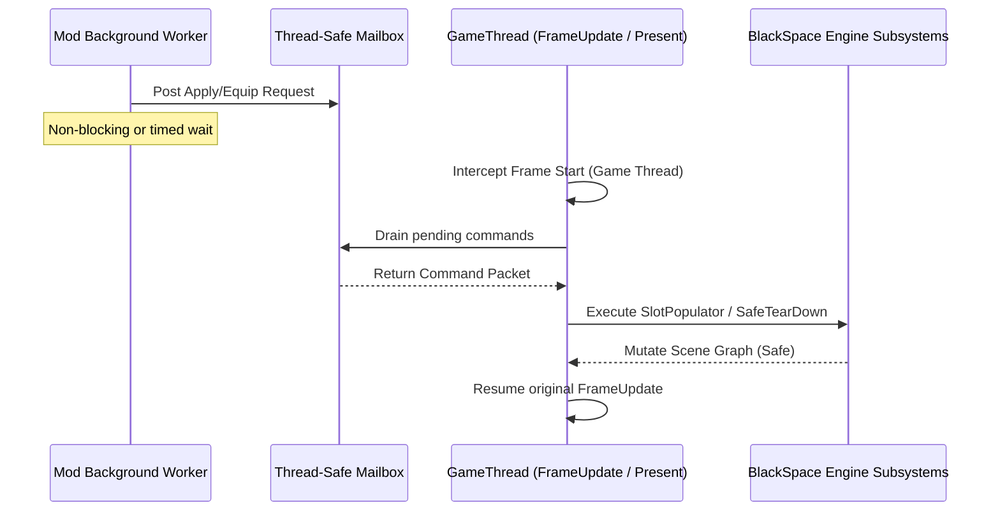
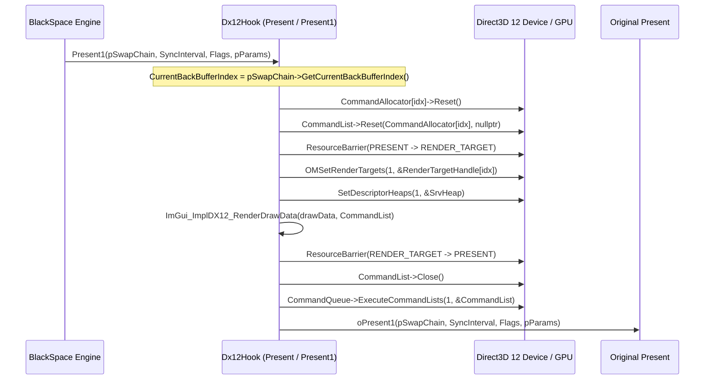
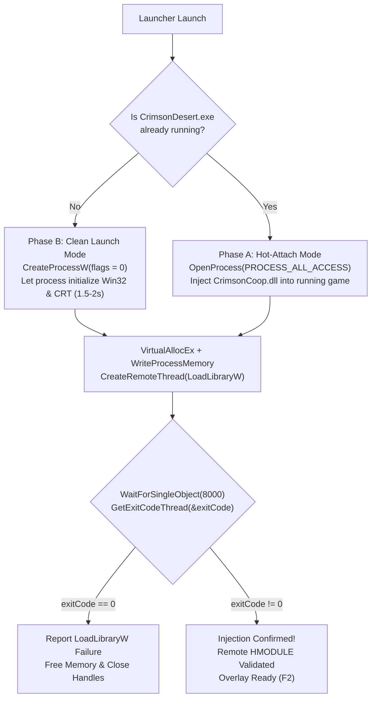

# BlackSpace Engine Reverse Engineering & Runtime Modding Reference
**Target Title:** Crimson Desert (BlackSpace Engine) Internals & Native ASI Architecture  
**Document Revision:** 1.0.0 (Authoritative Core Knowledge Base)  
**Target Executable Base:** `0x140000000` (x86-64 PE32+) | **Engine Namespace:** `pa::` (Pearl Abyss BlackSpace)  
**Verified Engine Builds:** Crimson Desert 1.04 – 2.05 (Builds 1.0.0.2800 – 1.0.0.2944+)

---

## Table of Contents
1. [BlackSpace Engine Architecture Overview](#1-blackspace-engine-architecture-overview)
2. [Static Chain Architecture & Identity Propagation](#2-static-chain-architecture--identity-propagation)
   - [2.1 Dual Root Resolution: Static Global vs. WorldSystem](#21-dual-root-resolution-static-global-vs-worldsystem)
   - [2.2 Downstream Traversal to pa::ClientUserActor](#22-downstream-traversal-to-paclientuseractor)
   - [2.3 The CCOIA Sub-Manager (+0x08) & Protagonist Anchors](#23-the-ccoia-sub-manager-0x08--protagonist-anchors)
   - [2.4 RTTI Self-Healing Landmark Architecture](#24-rtti-self-healing-landmark-architecture)
3. [Actor Containers & Enumeration Mechanics](#3-actor-containers--enumeration-mechanics)
   - [3.1 The 100-Entry Actor List in ChildContainerActorComponent](#31-the-100-entry-actor-list-in-childcontaineractorcomponent)
   - [3.2 The Dense Actor-Array Descriptor in pa::ClientActorManager](#32-the-dense-actor-array-descriptor-in-paclientactormanager)
   - [3.3 Structural Self-Healing for Descriptor Shift](#33-structural-self-healing-for-descriptor-shift)
4. [Protagonist Identification & Asset Path Classification](#4-protagonist-identification--asset-path-classification)
   - [4.1 Why Numeric Identity Bytes (+0x60/+0x63) Fail](#41-why-numeric-identity-bytes-0x600x63-fail)
   - [4.2 The Appearance XML Asset Path Chain](#42-the-appearance-xml-asset-path-chain)
   - [4.3 Dynamic RTTI Resolution of ClientCharacterControlActorComponent](#43-dynamic-rtti-resolution-of-clientcharactercontrolactorcomponent)
   - [4.4 Codename Substring Classification Algorithm](#44-codename-substring-classification-algorithm)
   - [4.5 Transient Mid-Teardown Fast-Path Fallbacks](#45-transient-mid-teardown-fast-path-fallbacks)
5. [World-Generation & Engine Lifecycle Tracking](#5-world-generation--engine-lifecycle-tracking)
   - [5.1 The Persistence Trap: Sub-Manager vs. Kliff CCOIA](#51-the-persistence-trap-sub-manager-vs-kliff-ccoia)
   - [5.2 Monotonic World Generation Counter Architecture](#52-monotonic-world-generation-counter-architecture)
   - [5.3 Differentiating In-Session Radial Swaps from World Rebuilds](#53-differentiating-in-session-radial-swaps-from-world-rebuilds)
6. [Complete AOB Signature Ladders & Disassembly Matrix](#6-complete-aob-signature-ladders--disassembly-matrix)
   - [6.1 Candidate Ladder Authoring Philosophy](#61-candidate-ladder-authoring-philosophy)
   - [6.2 ClientActorManagerGlobal Ladder (2-Tier Exhaustive)](#62-clientactormanagerglobal-ladder-2-tier-exhaustive)
   - [6.3 WorldSystem Ladder (3-Tier Inlined Getter & Fallbacks)](#63-worldsystem-ladder-3-tier-inlined-getter--fallbacks)
   - [6.4 VisualEquipChange Ladder (3-Tier Prologue & Register Shuffle)](#64-visualequipchange-ladder-3-tier-prologue--register-shuffle)
   - [6.5 BatchEquip Ladder (3-Tier Nibble Wildcard & Scratch Init)](#65-batchequip-ladder-3-tier-nibble-wildcard--scratch-init)
   - [6.6 Ancillary Engine Anchors: MapLookup & PartAddShow](#66-ancillary-engine-anchors-maplookup--partaddshow)
7. [Comprehensive ASI Modding Guide for BlackSpace Engine](#7-comprehensive-asi-modding-guide-for-blackspace-engine)
   - [7.1 Module Bootstrap, Threading, and Loader Lock Avoidance](#71-module-bootstrap-threading-and-loader-lock-avoidance)
   - [7.2 Memory Safety: SEH Framing & Plausibility Sanitization](#72-memory-safety-seh-framing--plausibility-sanitization)
   - [7.3 Hooking Policy & Game-Thread Synchronization](#73-hooking-policy--game-thread-synchronization)
   - [7.4 Surviving Game Patches & ABI Drift](#74-surviving-game-patches--abi-drift)
8. [Summary of Critical Engine Offsets & Constants](#8-summary-of-critical-engine-offsets--constants)
9. [DirectX 12 Presentation Pipeline & Streamline Interposer Hooks](#9-directx-12-presentation-pipeline--streamline-interposer-hooks)
   - [9.1 DXGI SwapChain VTable Topology](#91-dxgi-swapchain-vtable-topology)
   - [9.2 The CommandQueue Conundrum](#92-the-commandqueue-conundrum)
   - [9.3 Explicit Resource Barrier & Render Pass Lifecycle](#93-explicit-resource-barrier--render-pass-lifecycle)
10. [Windows NT Process Lifecycle, DRM Interactions & In-Memory Injection](#10-windows-nt-process-lifecycle-drm-interactions--in-memory-injection)
    - [10.1 The Suspended Process Deadlock Trap](#101-the-suspended-process-deadlock-trap)
    - [10.2 The Dual-Phase Injection Pattern](#102-the-dual-phase-injection-pattern)
    - [10.3 Security & Anti-Cheat Landscape](#103-security--anti-cheat-landscape)
11. [Save Game Sandboxing & Virtual File System Redirection (.cdcoop)](#11-save-game-sandboxing--virtual-file-system-redirection-cdcoop)
    - [11.1 Hooking kernel32.dll!CreateFileW](#111-hooking-kernel32dllcreatefilew)
    - [11.2 Custom .cdcoop Container Specification](#112-custom-cdcoop-container-specification)
12. [Native Steamworks SDR P2P Transport & Session Arbitration Protocol](#12-native-steamworks-sdr-p2p-transport--session-arbitration-protocol)
    - [12.1 Dynamic VTable Binding](#121-dynamic-vtable-binding)
    - [12.2 Session Arbitration: Trio vs. 2-Player Duo](#122-session-arbitration-trio-vs-2-player-duo)
    - [12.3 Conflict Resolution Protocol](#123-conflict-resolution-protocol)
13. [Mod Architecture Checklist & Troubleshooting Runbook](#13-mod-architecture-checklist--troubleshooting-runbook)

---

## 1. BlackSpace Engine Architecture Overview

Pearl Abyss' proprietary **BlackSpace Engine** is a high-throughput, multi-threaded C++ game engine designed for dense, seamless open-world simulation. In memory, it heavily features:
- **MSVC Polymorphic Class Hierarchies:** Pervasive use of virtual method tables (vtables) accompanied by complete Microsoft Complete Object Locator (COL) RTTI descriptors.
- **Component-Driven Actor Hierarchy:** Base actors (`pa::ClientActorBase`, `pa::ClientChildOnlyInGameActor`) own sparse, type-indexed pointer tables of actor components (`pa::ClientActorComponent`).
- **Separation of Authoritative vs. Visual Representations:** Gameplay systems operate on network-authoritative equipment and character descriptors, while the visual renderer constructs transient scene-graph representations (assembly nodes, prefab wrappers, and part socket lists) that are completely torn down and rebuilt across state transitions.
- **Actor Arena Pooling:** The engine dynamically recycles entity memory blocks across world zone loads, save-load cycles, and fast-travel. Consequently, **heap pointers must never be cached across frames without generation guards**.

---

## 2. Static Chain Architecture & Identity Propagation

The core gateway to controlling, inspecting, and synchronizing player character state in BlackSpace Engine is the **Actor Chain**.

### 2.1 Dual Root Resolution: Static Global vs. WorldSystem

BlackSpace Engine exposes two independent root landmarks that resolve to the same primary `pa::ClientActorManager` instance:

```mermaid
flowchart TD
    subgraph Root 1: Static Module Slot
        A["[ClientActorManagerGlobal]<br/>(AOB Resolved Slot)"] -->|*slot| B["pa::ClientActorManager"]
    end

    subgraph Root 2: WorldSystem Anchor
        WS["[WorldSystem]<br/>(AOB Resolved Slot)"] -->|*slot| WSI["WorldSystem Instance"]
        WSI -->|+0x30| B
    end

    B -->|+0x58 (Nominal / Healed)| C["pa::ClientUserActor"]
    C -->|+0x08| D["CCOIA Sub-manager"]
    D -->|+0x30| E["Kliff CCOIA (Always-Present Anchor)"]
    D -->|+0x38| F["Controlled CCOIA (Rotates on Swap)"]

    C -->|+0xD8 (Direct Root Path)| F
    C -->|+0x78| G["vec&lt;ActorComponent*&gt;"]
    G -->|+0x20 (vec[2])| H["pa::ClientChildContainerActorComponent"]
    H -->|+0x18| I["100-Entry Actor List (16-byte stride)"]
```

1. **Static Global Root (`ClientActorManagerGlobal`):**  
   A module-static qword pointer located in `.data` / `.bss`. It is populated during engine subsystem initialization. Consumed primarily by `CDCore` and `CrimsonCoop::BlackSpaceChain`.
2. **WorldSystem Root (`WorldSystem`):**  
   A module-static qword pointer pointing to the active `WorldSystem` singleton. Dereferencing `*(WorldSystem) + 0x30` yields `pa::ClientActorManager*`. Consumed by background worker threads in `LiveTransmog` and `EquipHide`.

### 2.2 Downstream Traversal to `pa::ClientUserActor`

From `pa::ClientActorManager`:
- Offset `+0x58` (`actor_chain_offsets::ACTOR_MANAGER_TO_USER_ACTOR`) stores the pointer to `pa::ClientUserActor`.
- **Patch Sensitivity:** Offset `+0x58` is the most volatile offset in the entire static chain. Whenever Pearl Abyss alters internal manager structures, this offset shifts. To achieve 100% resilience against updates, runtime ASI mods must implement an RTTI self-healing scanner around this field (detailed in [Section 2.4](#24-rtti-self-healing-landmark-architecture)).

### 2.3 The CCOIA Sub-Manager (+0x08) & Protagonist Anchors

`pa::ClientUserActor` does not directly embed protagonist transform or animation controllers; instead, it delegates to child actors categorized as **CCOIA** (`pa::ClientChildOnlyInGameActor`):

- **`UserActor + 0x08` (`OFF_SUB_MANAGER`):** Pointer to the **CCOIA Sub-manager**.
  - **`SubManager + 0x30` (`OFF_SUB_MGR_KLIFF`):** **Kliff CCOIA Anchor**.  
    *Critical Invariant:* Kliff's CCOIA pointer is **always present** in memory as long as a world is active, even when the player is currently piloting Damiane or Oongka. Kliff acts as the persistent engine anchor.
  - **`SubManager + 0x38` (`OFF_SUB_MGR_CTRL`):** **Currently-Controlled CCOIA**.  
    When the player controls Kliff, `+0x38 == +0x30`. When the player executes an in-game radial wheel switch to Damiane or Oongka, `+0x38` updates to point to that companion's CCOIA instance.
- **`UserActor + 0xD8` (`USER_ACTOR_TO_CONTROLLED`):** Direct shortcut pointer to the currently-controlled CCOIA, bypassing the sub-manager dereference.

### 2.4 RTTI Self-Healing Landmark Architecture

To eliminate patch downtime when `pa::ClientActorManager` struct layout mutates, `CDCore` deploys an MSVC RTTI Landmark scanner.

#### Mechanism:
1. Nominal target: `mgr_base + 0x58`.
2. Expected mangled RTTI name: `.?AVClientUserActor@pa@@`.
3. Search Window: `[-0x200, +0x200]` bytes around nominal `0x58` (configurable via INI `[Advanced] SelfHealWindow`).
4. Traversal Logic:
   - For every 8-byte aligned pointer in the window:
     - Check pointer plausibility (`is_plausible_ptr`).
     - Dereference object's vtable at `*ptr`.
     - Follow `vtable[-1]` to locate the MSVC `_RTTICompleteObjectLocator`.
     - Extract `TypeDescriptor` and inspect the ASCII mangled type name.
     - If the mangled name matches `.?AVClientUserActor@pa@@` exactly, store the new offset atomically and latch `s_chain_offsets_healed = true`.
5. **Decoy-Free Guarantee:** `pa::ClientActorManager` contains exactly one pointer to `pa::ClientUserActor`. All neighboring slots contain either non-polymorphic scalar handles or distinct component pointer arrays. Thus, within a 0x200-byte radius, zero false positives exist.

---

## 3. Actor Containers & Enumeration Mechanics

Modifications such as co-op sync, companion transmog, and global visual tweaks must enumerate all loaded actors in the player's vicinity.

### 3.1 The 100-Entry Actor List in ChildContainerActorComponent

Within `pa::ClientUserActor`:
- `UserActor + 0x78` (`OFF_USER_VEC`): Base pointer to dynamic actor component pointer array `vec<ActorComponent*>`.
- `Vector Base + 0x20` (`vec[2]` under 16-byte stride): Points to `pa::ClientChildContainerActorComponent`.
- `ChildContainer + 0x18` (`OFF_CHILD_LIST`): Pointer to a dedicated **100-entry Actor List**.

#### Memory Layout of the 100-Entry Actor List:
```text
[ChildContainerActorComponent + 0x18] -> Array Base
  Capacity: Fixed 100 entries (ACTOR_LIST_CAPACITY = 100)
  Stride:   16 bytes (ACTOR_LIST_STRIDE = 16)

Entry Layout:
  +0x00 (qword):  uintptr_t ccoia       (Pointer to pa::ClientChildOnlyInGameActor, or 0)
  +0x08 (qword):  uint64_t flag         (Live entry bitmask / state, typically 0x0101)
```

#### Typical Actor Insertion Order:
- `Entry[0]`: Kliff CCOIA (Always present).
- `Entry[1]`: Damiane CCOIA (Present when unlocked/spawned).
- `Entry[2]`: Oongka CCOIA (Present when unlocked/spawned).
- `Entry[3..99]`: Active party companions, summoned mounts, humanoid followers.

> [!NOTE]
> The 100-entry list is primarily diagnostic. It is sparsely populated and can experience internal fragmentation when companions despawn. For hot-path companion discovery, the Actor-Array Descriptor is preferred.

### 3.2 The Dense Actor-Array Descriptor in `pa::ClientActorManager`

Inside `pa::ClientActorManager`, the engine maintains a sequence of uniform 16-byte vector descriptors:

```text
Record Layout (16 bytes):
  +0x00 (qword):  uintptr_t array_ptr   (Pointer to continuous 8-byte stride CCOIA buffer)
  +0x08 (dword):  uint32_t live_count   (Active elements currently in the list)
  +0x0C (dword):  uint32_t capacity     (Total allocated capacity)
```

Nominal offset: `mgr_base + 0x128` (`OFF_MGR_ACTOR_ARRAY_NOMINAL`).

Unlike the 100-entry list, the Actor-Array is a **dense spawn-order buffer**. It houses:
1. Kliff at `array[0]`.
2. Other protagonists (Damiane, Oongka).
3. **Every humanoid NPC and enemy in the active simulation sector.**

> [!WARNING]
> In large combat scenes or crowded settlements, protagonists are **not** clustered at indices `[1]` and `[2]`. Damiane or Oongka may land at index `[48]` or `[127]`, interleaved with dozens of enemy foot-soldiers. An actor scanner must scan up to the live `capacity` and filter by appearance asset path.

### 3.3 Structural Self-Healing for Descriptor Shift

Because the descriptor offset (`0x128`) can move independently of `UserActor` (`0x58`), `CDCore` deploys a structural scanner (`heal_mgr_actor_array`):
1. Sweep `mgr_base + 0x000` to `mgr_base + 0x400` in 8-byte increments.
2. For each candidate record:
   - Verify `array_ptr` is a plausible user-mode pointer.
   - Verify `capacity` is within bounds (`16 <= cap <= 8192`).
   - Verify `live_count <= capacity`.
   - Read `array_ptr[0]`. If `array_ptr[0] == kliff_ccoia`, the candidate is a valid actor array.
3. If multiple sibling arrays lead with Kliff (e.g., filtered sub-systems), select the candidate with the **largest capacity** (the master dense array).
4. Cache the resulting offset atomically.

---

## 4. Protagonist Identification & Asset Path Classification

Accurately determining which protagonist an arbitrary CCOIA pointer represents is the single most critical task for multi-character logic.

### 4.1 Why Numeric Identity Bytes (+0x60/+0x63) Fail

Early reverse engineering noted a packed DWORD at `CCOIA + 0x60`:
- Byte `+0x60`: Session-local instance index.
- Byte `+0x63`: Type discriminator (`0xA0` for Kliff, `0xB0` for others).

**Flaws in Byte Discriminators:**
1. **Low-Byte Volatility:** The `+0x60` byte varies unpredictably across sessions (e.g., Kliff is `0x01` in one save, `0x05` in another).
2. **Companion Indistinguishability:** Damiane, Oongka, and all humanoid NPCs share the same `0xB0` tag at `+0x63`. Numeric tags cannot distinguish Damiane from Oongka or an NPC follower.
3. **Archetype Collisions:** Sibling body-mesh paths (`+0x28 -> +0x18`) only distinguish skeleton models (`phm` = Player Human Male, `phw` = Player Human Female). A new female character sharing Damiane's skeleton would collide.

### 4.2 The Appearance XML Asset Path Chain

The definitive, immutable ground truth for actor identity in BlackSpace Engine is the **Appearance XML Asset Path**. The engine attaches an `.app_xml` asset descriptor to every protagonist upon instantiation.

```text
CCOIA (pa::ClientChildOnlyInGameActor)
  +0x68 -> Component Pointer Table (p1)
    [Find component of RTTI type: .?AVClientCharacterControlActorComponent@pa@@] (ccc)
      +0x40 -> p3
        +0x38 -> MSVC std::string struct
          +0x00 -> ASCII buffer pointer (or inline buffer if short)
```

#### Ground Truth Asset Paths:
- **Kliff:**  
  `character/appearance/1_pc/1_phm/cd_phm_macduff/cd_phm_macduff_00000.app_xml`  
  *(Internal codename: `cd_phm_macduff`)*
- **Damiane:**  
  `character/appearance/1_pc/2_phw/cd_phw_damian/cd_phw_damian_00000.app_xml`  
  *(Internal codename: `cd_phw_damian`)*
- **Oongka:**  
  `character/appearance/1_pc/1_phm/cd_phm_oongka/cd_phm_oongka_00000.app_xml`  
  *(Internal codename: `cd_phm_oongka`)*

### 4.3 Dynamic RTTI Resolution of `ClientCharacterControlActorComponent`

The component table at `CCOIA + 0x68` is a dynamic, sparse array of component pointers.
- In early scene loading (~5 components attached), `pa::ClientCharacterControlActorComponent` lands at `p1 + 0x48`.
- In steady state (~22 components attached), it migrates to `p1 + 0x40`.

Hardcoding `+0x40` creates race conditions during loading screens. The correct solution:
```cpp
// Scan p1 slots (bounded to 64 pointers) using MSVC RTTI
constexpr std::string_view CCC_RTTI_NAME = ".?AVClientCharacterControlActorComponent@pa@@";
static DetourModKit::rtti::PointerTableCache s_ccc_vtable_cache;

uintptr_t ccc = CDCore::find_component_in_table(p1, CCC_RTTI_NAME, s_ccc_vtable_cache);
```
On cold boot, `find_in_pointer_table` inspects each slot's RTTI `TypeDescriptor`. Once located, it caches the class vtable pointer in `s_ccc_vtable_cache`. All subsequent calls across the process lifetime execute as a single fast qword comparison per slot!

### 4.4 Codename Substring Classification Algorithm

To prevent false positives from directory path prefix collisions:
1. Search the extracted string for the anchor token `"/cd_"`.
2. Slice the string to inspect only the suffix following `"/cd_"`.
3. Match against the canonical codename set:
   - `suffix.find("cd_phm_macduff") != npos` $\rightarrow$ **Kliff (ID 1)**
   - `suffix.find("cd_phw_damian") != npos` $\rightarrow$ **Damiane (ID 2)**
   - `suffix.find("cd_phm_oongka") != npos` $\rightarrow$ **Oongka (ID 3)**
   - No match $\rightarrow$ **Unknown / NPC (ID 0)**

### 4.5 Transient Mid-Teardown Fast-Path Fallbacks

During cutscenes, radial menu transitions, or save-load teardown windows, the component table at `CCOIA + 0x68` may transiently contain null entries.
- If `classify_by_appearance(ccoia)` fails, the resolver inspects `CCOIA + 0x60`.
- If `((packed >> 24) & 0xFF) == 0xA0`, the actor is definitively classified as **Kliff**.
- Damiane and Oongka cannot be safely distinguished without appearance components; the resolver safely returns `ControlledCharacter::Unknown` rather than making an unsafe guess.

---

## 5. World-Generation & Engine Lifecycle Tracking

ASI mods running background loops (e.g., networking, physics hooks, transmog enforcers) must detect when the game rebuilds its world to avoid referencing dangling memory.

### 5.1 The Persistence Trap: Sub-Manager vs. Kliff CCOIA

A common architectural trap in BlackSpace Engine reverse engineering is attempting to detect level changes via the CCOIA Sub-manager:
$$\text{UserActor} \rightarrow +0x08 \rightarrow \text{CCOIA Sub-manager}$$

> [!CAUTION]
> The CCOIA Sub-manager allocation at `UserActor + 0x08` is **persistent for the entire lifetime of the game process**. Its pointer address never changes during save reloading, fast-travel, or death respawns.

In contrast, **Kliff's CCOIA instance (`sub_mgr + 0x30`) is completely freed and reallocated in the heap on every single world reconstruction.**

### 5.2 Monotonic World Generation Counter Architecture

The engine lifecycle tracker monitors the qword at `SubManager + 0x30`:

```cpp
// Atomically observe Kliff CCOIA
uintptr_t current_kliff = read_ptr(sub_mgr + 0x30);
uintptr_t last_kliff = s_cached_kliff_ccoia.load(std::memory_order_acquire);

if (current_kliff != last_kliff && is_plausible_ptr(current_kliff)) {
    if (s_cached_kliff_ccoia.compare_exchange_strong(last_kliff, current_kliff,
                                                      std::memory_order_acq_rel,
                                                      std::memory_order_acquire)) {
        // Increment monotonic generation counter
        s_world_generation.fetch_add(1, std::memory_order_acq_rel);
    }
}
```

Consumers cache `uint64_t local_generation`. If `GetWorldGeneration() != local_generation`, the consumer drops all cached CCOIAs, clears packet interpolation buffers, and re-initializes actor hooks.

### 5.3 Differentiating In-Session Radial Swaps from World Rebuilds

BlackSpace Engine allows players to seamlessly switch between Kliff, Damiane, and Oongka using a radial wheel:

| Event Type | SubManager + 0x30 (Kliff Anchor) | SubManager + 0x38 (Controlled Actor) | World Generation Counter | Action Required |
| :--- | :--- | :--- | :--- | :--- |
| **Radial Character Swap** | **Unchanged** | Rotates to new CCOIA | **Unchanged** | Switch input bindings, update UI overlay, adjust local camera offset. |
| **Fast Travel / Level Load** | **Reallocated (New Ptr)** | Reallocated (New Ptr) | **Incremented (+1)** | **Flush all actor caches**, reset network proxies, rebuild transmog mappings. |
| **Cutscene Playback** | Unchanged | Transiently reassigned / 0 | Unchanged | Suppress local movement packets, preserve session state. |

---

## 6. Complete AOB Signature Ladders & Disassembly Matrix

To ensure survivability across patches, every critical anchor is implemented as a multi-tier candidate ladder.

### 6.1 Candidate Ladder Authoring Philosophy
1. **Sign Code, Not Data:** Match instruction sequences, never hardcoded `.data` pointers.
2. **Wildcard Volatile Fields:** Wildcard immediate operands, displacement offsets (`disp8`/`disp32`), and register bit encodings where compilers reorder allocation.
3. **Bounded Gaps:** Compilers freely interchange 2-byte short jumps (`74 xx`) and 6-byte near jumps (`0F 84 xx xx xx xx`). Use bounded wildcards (e.g., `[2-6]`) to bridge jump instructions.
4. **Enforce Uniqueness:** Every ladder pattern must match **exactly once** in the executable's `.text` section. If an AOB matches multiple sites, `require_unique` discards it as ambiguous.

---

### 6.2 `ClientActorManagerGlobal` Ladder (2-Tier Exhaustive)

This global holds the `pa::ClientActorManager*` singleton. Exactly two instructions in the entire binary reference this pointer.

#### Tier P1: `ClientActorManagerGlobal_P1_PublishStore`
- **Semantics:** The engine's publish routine storing the initialized manager pointer into the global slot, followed by stores for two sibling sub-pointers and a state byte flag.
- **Kind:** `RipRelative` (Displacement at byte 3, instruction length 7).
- **Pattern:**
  ```text
  4? 89 ?? ?? ?? ?? ?? 4? 8D ?? ?? ?? ?? ?? 48 89 05 ?? ?? ?? ?? 4? 8? ?? ?? ?? ?? ?? 48 89 05 ?? ?? ?? ?? 0F B6 85 ?? ?? ?? ?? 88 05
  ```
- **Disassembly Breakdown:**
  ```x86asm
  mov [rip+disp32], reg        ; Slot +0x00: Publishes pa::ClientActorManager* (Target)
  lea reg, [reg+disp32]        ; Sub-object offset
  mov [rip+disp32], rax        ; Sibling Slot +0x08
  lea reg, [reg+disp32]        ; Or mov reg, [rbp+disp32]
  mov [rip+disp32], rax        ; Sibling Slot +0x10
  movzx eax, byte ptr [rbp+d32]; Subsystem state flag
  mov [rip+disp32], al         ; Sibling Slot +0x18
  ```

#### Tier P2: `ClientActorManagerGlobal_P2_LeaCallBodyDisp8`
- **Semantics:** The only read of the slot in the engine. Located in the lazy-init accessor where the global slot is loaded via `lea rdx, [rip+disp32]` as an outbound argument.
- **Kind:** `RipRelative` (Displacement at byte 3, instruction length 7).
- **Pattern:**
  ```text
  48 8D 4? 10 4? 83 E? 01 [2-6] EB 02 33 ?? | 48 8D 15 ?? ?? ?? ?? 48 8D 4D ?? E8 ?? ?? ?? ?? 90 C6 44 24 ?? 00 C5 F9 EF C0
  ```
- **Disassembly Breakdown:**
  ```x86asm
  lea rcx, [rcx+0x10]          ; Loop pointer step
  sub r8, 1                    ; Loop decrement
  jne loop_body                ; [2-6] bounded gap
  jmp over_xor
  xor ebx, ebx
  over_xor:
  lea rdx, [rip+disp32]        ; <-- TARGET INSTRUCTION (marked by '|')
  lea rcx, [rbp-disp8]         ; Outbound argument
  call helper_func             ; Initialization call
  nop
  mov byte ptr [rsp+disp8], 0
  vpxor xmm0, xmm0, xmm0
  ```

> [!WARNING]
> **The Third-Row Trap:** A byte-identical `lea/lea/call/nop/vpxor` block exists adjacent to P2. However, that neighboring block loads an unrelated subsystem global. Do **not** create a P3 candidate from that block; it passes all scan checks but resolves to the wrong global.

---

### 6.3 `WorldSystem` Ladder (3-Tier Inlined Getter & Fallbacks)

Resolves the static slot pointing to the `WorldSystem` instance.

#### Tier P1: `WorldSystem_P1_InlinedGetterThroughVCall`
- **Semantics:** Inlined accessor body traversing container count at `+0x28` through virtual call `[rax+0x40]`.
- **Kind:** `RipRelative` (Disp at 3, len 7).
- **Pattern:**
  ```text
  48 8B 05 ?? ?? ?? ?? 48 8B 88 D8 00 00 00 48 8B 41 20 83 78 28 00 [2-6] 33 C9 [2-5] 48 8B 40 20 48 8B 48 10 48 8B 01 FF 50 40
  ```
- **Disassembly Breakdown:**
  ```x86asm
  mov rax, [rip+disp32]        ; Load WorldSystem slot
  mov rcx, [rax+0xD8]          ; Container walk
  mov rax, [rcx+0x20]
  cmp dword ptr [rax+0x28], 0  ; Empty check
  ja has_elements              ; [2-6] gap
  xor ecx, ecx
  jmp done                     ; [2-5] gap
  has_elements:
  mov rax, [rax+0x20]
  mov rcx, [rax+0x10]
  mov rax, [rcx]
  call qword ptr [rax+0x40]    ; Dispatch virtual call
  ```

#### Tier P2: `WorldSystem_P2_StructField`
- **Pattern:**
  ```text
  80 B8 ?? ?? ?? ?? 00 [2-6] | 48 8B 05 ?? ?? ?? ?? 48 8B 88 D8 00 00 00
  ```
- **Disassembly Breakdown:**
  ```x86asm
  cmp byte ptr [rax+disp32], 0 ; State check
  jne skip_branch              ; [2-6] gap
  mov rax, [rip+disp32]        ; <-- TARGET INSTRUCTION (marked by '|')
  mov rcx, [rax+0xD8]          ; Game-ABI disambiguator
  ```

#### Tier P3: `WorldSystem_P3_ContainerWalkToCall`
- **Pattern:**
  ```text
  48 8B 05 ?? ?? ?? ?? 48 8B 58 58 48 8D 54 24 ?? 48 8B CB
  ```
- **Disassembly Breakdown:**
  ```x86asm
  mov rax, [rip+disp32]        ; Load WorldSystem
  mov rbx, [rax+0x58]          ; Walk container
  lea rdx, [rsp+disp8]         ; Outbound stack arg
  mov rcx, rbx                 ; Pass container
  ```

---

### 6.4 `VisualEquipChange` Ladder (3-Tier Prologue & Register Shuffle)

The central bottleneck function called by the network handler for `TrocTrAddVisualEquipItemAck`. Handles visual attachment/detachment of equipment meshes.

**Function Signature (x64 `__fastcall`):**
```cpp
int64_t VisualEquipChange(
    void*   body_comp,    // RCX: ClientFrameEventActorComponent*
    int16_t slot_id,      // DX:  Equipment slot ID
    int16_t item_id,      // R8W: Item prefab ID (0xFFFF = unequip)
    void*   item_data     // R9:  Item metadata struct pointer
);
```

#### Tier P1: `VisualEquipChange_P1_FullPrologue`
- **Kind:** `Direct` (Returns entry address).
- **Pattern:**
  ```text
  48 89 5C 24 10 48 89 74 24 20 66 44 89 44 24 18 55 57 41 54 41 56 41 57 48 8D AC 24 ?? ?? ?? ?? B8 ?? ?? ?? ??
  ```
- **Disassembly Breakdown:**
  ```x86asm
  mov [rsp+0x10], rbx          ; Register saves
  mov [rsp+0x20], rsi
  mov [rsp+0x18], r8w          ; Save item_id
  push rbp
  push rdi
  push r12
  push r14
  push r15
  lea rbp, [rsp-disp32]        ; Frame setup
  mov eax, imm32               ; __chkstk allocation size
  ```

#### Tier P2: `VisualEquipChange_P2_PushFrame`
- **Kind:** `Direct` (Walk-back: `-0x10`).
- **Pattern:**
  ```text
  55 57 41 54 41 56 41 57 48 8D AC 24 ?? ?? ?? ?? B8 ?? ?? ?? ?? E8 ?? ?? ?? ?? 48 2B E0 49 8B F1 41 0F B7 D8
  ```
- **Disassembly Breakdown:**
  ```x86asm
  push rbp / push rdi / push r12 / push r14 / push r15
  lea rbp, [rsp-disp32]
  mov eax, imm32
  call __chkstk                ; Allocate stack frame
  sub rsp, rax
  mov rsi, r9                  ; Save item_data
  movzx ebx, r8w               ; Save item_id
  ```

#### Tier P3: `VisualEquipChange_P3_PreLeaBody`
- **Kind:** `Direct` (Walk-back: `-0x2D`).
- **Pattern:**
  ```text
  49 8B F1 41 0F B7 D8 0F B7 FA 4C 8B F1 48 8D 8D ?? ?? ?? ??
  ```
- **Disassembly Breakdown:**
  ```x86asm
  mov rsi, r9                  ; Post-alloca argument shuffle
  movzx ebx, r8w
  movzx edi, dx                ; Zero-extend slot_id
  mov r14, rcx                 ; Save body_comp
  lea rcx, [rbp+disp32]        ; Prepare scratch descriptor
  ```

---

### 6.5 `BatchEquip` Ladder (3-Tier Nibble Wildcard & Scratch Init)

Invoked when equipment loadouts are applied in batch or when full armor sets swap.

**Function Signature (x64 `__fastcall`):**
```cpp
uint32_t* BatchEquip(
    uint64_t*  a1,           // RCX: Authority table context
    uint32_t*  a2,           // RDX: Dispatch flag
    int64_t**  a3_old,       // R8:  Old item swap entry list
    int64_t**  a4_new        // R9:  New item swap entry list
);
```

#### Tier P1: `BatchEquip_P1_FullPrologue`
- **Kind:** `Direct` (Returns entry address).
- **Pattern:**
  ```text
  48 89 5C 24 10 55 56 57 41 54 41 55 41 56 41 57 48 8D AC 24 ?? ?? ?? ?? B8 ?? ?? ?? ?? E8 ?? ?? ?? ?? 48 2B E0 4? 8B ?? 4? 8B ?? 4? 8B ?? 4? 8B ?? 08
  ```
- **Design Note on `4? 8B`:** The post-alloca shuffle moves `a1..a4` into non-volatile registers. The compiler freely rotates between legacy (`rbx`, `rsi`, `rdi`) and extended (`r12`–`r15`) registers across minor updates. Using nibble mask `4? 8B ??` matches both `48 8B` and `4C 8B` without breaking on register rotation!

#### Tier P2: `BatchEquip_P2_PostAlloca`
- **Kind:** `Direct` (Walk-back: `-0x22`).
- **Pattern:**
  ```text
  48 2B E0 4? 8B ?? 4? 8B ?? 4? 8B ?? 4? 8B ?? 08 48 8D 45 ?? 48 89 45 ?? 33 C9
  ```

#### Tier P3: `BatchEquip_P3_BodyScratchInit`
- **Kind:** `Direct` (Walk-back: `-0x32`).
- **Pattern:**
  ```text
  48 8D 45 ?? 48 89 45 ?? 33 C9 89 4D ?? C7 45 ?? 02 00 00 00 48 8D 85 ?? ?? ?? ?? 48 89 85 ?? ?? ?? ?? 89 8D ?? ?? ?? ?? C7 85 ?? ?? ?? ?? 14 00 00 00
  ```
- **Semantics:** Anchors on the initialization of two on-stack scratch vector descriptors:
  - Vector 1 initialized with capacity `0x02`.
  - Vector 2 initialized with capacity `0x14` (20 items).
  Both capacity constants are semantic and invariant across builds.

---

### 6.6 Ancillary Engine Anchors: `MapLookup` & `PartAddShow`

#### `MapLookup` (Global String Hash Lookup)
Used to look up `IndexedStringA` table entries for internal item and bone socket names.
- **P1 Direct Prologue:**
  ```text
  48 83 EC 08 83 79 04 00 4C 8B C1 ?? ?? 33 C0 48 83 C4 08 C3 48 8B 05 ?? ?? ?? ?? 48 89 1C 24 8B 1A
  ```
- **P2 Hash Body (Walk-back `-0x24`):**
  ```text
  8B 48 ?? 48 03 D2 44 8B 5C D1 ?? 41 8B 08 85 C9 ?? ?? 33 D2 41 8B C3 F7 F1
  ```

#### `PartAddShow` (Part Show Mask Bypass Filter)
Hooked by visual mods to suppress stale gear flashes during glide exit and dismount transitions.
- **P1 Full Prologue:**
  ```text
  40 53 57 41 5? 48 83 EC ?? 48 8B 59 ?? 4D 8B ?? 44 8B 89 ?? ?? ?? ?? 48 8B F9
  ```
- **P2 Post-Prologue (Walk-back `-5`):**
  ```text
  48 83 EC ?? 48 8B 59 ?? 4D 8B ?? 44 8B 89 ?? ?? ?? ??
  ```
- **P3 Show-List Setup (Walk-back `-0x17`):**
  ```text
  48 8B F9 41 8B C1 48 C1 E0 04 48 03 C3 C5 F8 29 74 24 ?? C5 F8 28 F3 48 3B D8
  ```

---

## 7. Comprehensive ASI Modding Guide for BlackSpace Engine

This section provides practical guidelines for writing native `.asi` or `.dll` mods loaded into Crimson Desert via standard ASI loaders (`dinput8.dll`, `dxgi.dll`, or `version.dll`).

### 7.1 Module Bootstrap, Threading, and Loader Lock Avoidance

Never execute complex scans or hook installations inside `DllMain`. The Windows OS Loader Lock restricts thread creation, synchronization primitives, and external I/O.

```cpp
#include <windows.h>
#include <thread>

void MainModThread(HMODULE hModule) {
    // 1. Wait for game unpack/initialization
    while (!GetModuleHandleA("CrimsonDesert.exe")) {
        std::this_thread::sleep_for(std::chrono::milliseconds(100));
    }

    // 2. Perform candidate ladder scans
    if (!InitializeEngineAnchors()) {
        OutputDebugStringA("[Mod] Failed to resolve critical anchors. Aborting.\n");
        return;
    }

    // 3. Install game hooks / Present detours
    InstallHooks();

    // 4. Background state loop (Poll rate ~1Hz to 60Hz depending on role)
    while (!g_ShutdownRequested) {
        std::this_thread::sleep_for(std::chrono::milliseconds(16));
        // Perform non-mutating state reads or trigger mailboxes
    }
}

BOOL APIENTRY DllMain(HMODULE hModule, DWORD ul_reason_for_call, LPVOID lpReserved) {
    if (ul_reason_for_call == DLL_PROCESS_ATTACH) {
        DisableThreadLibraryCalls(hModule);
        std::thread(MainModThread, hModule).detach();
    }
    return TRUE;
}
```

### 7.2 Memory Safety: SEH Framing & Plausibility Sanitization

Because BlackSpace Engine rapidly rotates heap addresses and zeroes component tables during world loading, **bare pointer dereferencing will crash the game**.

#### Sanitization Gate:
Always validate pointers before dereferencing:
```cpp
inline bool IsPlausibleUserPtr(uintptr_t addr) noexcept {
    // Canonical 64-bit Windows user-mode virtual address range
    return addr >= 0x10000ULL && addr <= 0x7FFFFFFFFFFFULL;
}
```

#### Structured Exception Handling (SEH):
Wrap all dynamic static-chain traversals in `__try ... __except`:
```cpp
uintptr_t SafeReadPointerChain(uintptr_t base, const std::vector<std::ptrdiff_t>& offsets) noexcept {
    if (!IsPlausibleUserPtr(base)) return 0;
    
    uintptr_t current = base;
    __try {
        for (std::ptrdiff_t off : offsets) {
            current = *reinterpret_cast<const volatile uintptr_t*>(current + off);
            if (!IsPlausibleUserPtr(current)) return 0;
        }
        return current;
    }
    __except (EXCEPTION_EXECUTE_HANDLER) {
        // Intercept Access Violations (0xC0000005) cleanly during save-load transitions
        return 0;
    }
}
```

### 7.3 Hooking Policy & Game-Thread Synchronization

> [!IMPORTANT]
> **The Thread Boundary Rule:** BlackSpace Engine is **not thread-safe** with respect to scene graph modifications, actor component registration, and equipment manipulation.

- **Prohibited:** Calling engine functions (`SlotPopulator`, `SafeTearDown`, `VisualEquipChange`, actor spawn APIs) from your mod's background worker threads. Doing so corrupts lock-free appearance-claim vectors and triggers heap corruptions.
- **Sanctioned Execution Model:**
  1. Background workers collect requests (hotkeys, UI clicks, network sync packets) and post them to a **thread-safe mailbox**.
  2. Install a hook on the main engine update loop (`FrameUpdate`) or DirectX 12 `IDXGISwapChain::Present`.
  3. When the hook fires on the **Game Thread**, drain the mailbox and invoke engine APIs synchronously.



### 7.4 Surviving Game Patches & ABI Drift

When Pearl Abyss releases an engine update:
1. **Never Hardcode Absolute RVAs:** Always rely on candidate ladders that resolve RIP-relative instructions.
2. **Decouple Struct Offsets:** Do not assume that because offset $A$ drifted by $+0x08$, offset $B$ shifted by the same amount. Each struct offset must be measured from live code or discovered via RTTI.
3. **Corroborate with Class RTTI:**
   - Verify that the pointer in `ClientActorManagerGlobal` points to an object whose vtable matches `.?AVClientActorManager@pa@@`.
   - If the type check fails, immediately disable hook installation to prevent executing code against an incompatible memory layout.
4. **Clean Detours on Unload:**
   - If developing reloadable DLLs for rapid iteration, track all installed hooks in a LIFO stack.
   - At shutdown, unhook all functions newest-first. Verify that trampolines are restored before freeing memory.

---

## 8. Summary of Critical Engine Offsets & Constants

For rapid integration into external C++ codebases, the table below consolidates the definitive constants:

| Metric / Landmark | Value / Offset | Type / Signature | Description |
| :--- | :--- | :--- | :--- |
| `ACTOR_MANAGER_TO_USER_ACTOR` | `+0x58` | `std::ptrdiff_t` | Offset from `pa::ClientActorManager` to `pa::ClientUserActor`. Target of RTTI heal. |
| `WORLD_SYSTEM_TO_ACTOR_MANAGER`| `+0x30` | `std::ptrdiff_t` | Offset from `WorldSystem` instance to `pa::ClientActorManager`. |
| `USER_ACTOR_TO_SUB_MANAGER` | `+0x08` | `std::ptrdiff_t` | Offset from `pa::ClientUserActor` to CCOIA Sub-manager. |
| `SUB_MGR_TO_KLIFF_CCOIA` | `+0x30` | `std::ptrdiff_t` | Kliff CCOIA pointer (Permanent world anchor). |
| `SUB_MGR_TO_CONTROLLED_CCOIA` | `+0x38` | `std::ptrdiff_t` | Currently-controlled CCOIA pointer. |
| `USER_ACTOR_TO_CONTROLLED` | `+0xD8` | `std::ptrdiff_t` | Direct path from `pa::ClientUserActor` to controlled CCOIA. |
| `USER_ACTOR_TO_COMP_VEC` | `+0x78` | `std::ptrdiff_t` | Vector of `ActorComponent*`. |
| `VEC_CHILD_CONTAINER_SLOT` | `+0x20` | `std::ptrdiff_t` | `vec[2]` (16-byte stride) $\rightarrow$ `pa::ClientChildContainerActorComponent*`. |
| `CHILD_CONTAINER_ACTOR_LIST` | `+0x18` | `std::ptrdiff_t` | Base of 100-entry Actor List (16-byte stride). |
| `OFF_MGR_ACTOR_ARRAY_NOMINAL` | `+0x128` | `std::ptrdiff_t` | Master dense actor array descriptor in `pa::ClientActorManager`. |
| `CCOIA_TO_COMPONENT_TABLE` | `+0x68` | `std::ptrdiff_t` | Component pointer table base (`p1`). |
| `COMPONENT_TABLE_EQUIP_SLOT` | `+0x38` | `std::ptrdiff_t` | `pa::ClientEquipSlotActorComponent*` (`a1`). |
| `EQUIP_SLOT_CCOIA_BACKREF` | `+0x08` | `std::ptrdiff_t` | Back-pointer from equip-slot component to owning CCOIA. |
| `CCC_TO_APP_PATH_P3` | `+0x40` | `std::ptrdiff_t` | Offset from `ClientCharacterControlActorComponent` to `p3`. |
| `APP_P3_TO_STRING_STRUCT` | `+0x38` | `std::ptrdiff_t` | Offset from `p3` to `std::string` appearance XML asset path. |
| `STRING_HEAP_BUF_PTR` | `+0x00` | `std::ptrdiff_t` | MSVC `std::string` buffer pointer (when size $\ge 16$). |
| `Kliff Codename` | `"cd_phm_macduff"`| `string_view` | Matches `.../cd_phm_macduff_00000.app_xml`. |
| `Damiane Codename` | `"cd_phw_damian"` | `string_view` | Matches `.../cd_phw_damian_00000.app_xml`. |
| `Oongka Codename` | `"cd_phm_oongka"` | `string_view` | Matches `.../cd_phm_oongka_00000.app_xml`. |

---

## 9. DirectX 12 Presentation Pipeline & Streamline Interposer Hooks

BlackSpace Engine employs a modern, asynchronous DirectX 12 render pipeline tightly integrated with NVIDIA Streamline (`sl.interposer.dll`), AMD FidelityFX (`amd_fidelityfx_loader_dx12.dll`), and Intel XeSS (`libxess.dll`). Understanding this pipeline is essential for stable in-game UI injection.

### 9.1 DXGI SwapChain VTable Topology

The game presents frames via a modern flip-model swapchain. To maintain complete coverage across borderless windowed, exclusive fullscreen, and frame-generation modes, mods must hook both `Present` and `Present1`:

| Interface | VTable Index | Method Name | Hook Purpose |
| :--- | :--- | :--- | :--- |
| `IDXGISwapChain` | **8** | `Present` | Intercepts standard presentation calls. |
| `IDXGISwapChain` | **13** | `ResizeBuffers` | Handles window resizing, device resets, and fullscreen toggles. Frees and recreates RTVs. |
| `IDXGISwapChain1` | **22** | `Present1` | Intercepts modern flip-model presentations with dirty-rect optimization (used by BlackSpace). |
| `ID3D12CommandQueue` | **10** | `ExecuteCommandLists` | Captures the game's native `DIRECT` command queue for UI draw call submission. |

### 9.2 The CommandQueue Conundrum

In DirectX 12, a custom command queue instantiated via `pDevice->CreateCommandQueue` **cannot** record commands writing to swapchain backbuffers owned by another queue. Attempting to do so triggers DXGI device removal:
$$\text{D3D12 ERROR: A command list writing to a swap chain back buffer may only be executed on the queue associated with that buffer.}$$

#### Solution: Dynamic Command Queue Interception
1. Hook `ID3D12CommandQueue::ExecuteCommandLists` (VTable index 10) on a dummy queue created at startup.
2. When the engine submits draw lists, inspect `pCommandQueue->GetDesc().Type`.
3. If `Type == D3D12_COMMAND_LIST_TYPE_DIRECT`, record the pointer into `g_d3d12CommandQueue`.
4. As a fallback, query `pSwapChain->GetDevice(__uuidof(ID3D12CommandQueue), ...)`.

### 9.3 Explicit Resource Barrier & Render Pass Lifecycle

Every frame rendered into the backbuffer must adhere to strict DirectX 12 state transitions:



---

## 10. Windows NT Process Lifecycle, DRM Interactions & In-Memory Injection

### 10.1 The Suspended Process Deadlock Trap

A common failure mode when writing custom game launchers is injecting a DLL into a process created with `CREATE_SUSPENDED`:
1. `CreateProcessW(..., CREATE_SUSPENDED, ...)` halts the primary thread before `ntdll!LdrpInitializeProcess` completes.
2. Calling `CreateRemoteThread` to run `LoadLibraryW` spawns a thread that attempts to acquire the Windows OS Loader Lock (`LdrpLoaderLock`).
3. Because the suspended main thread is in the middle of process initialization, the remote thread deadlocks waiting for the loader lock.
4. If the launcher relies on a fixed 5-second `WaitForSingleObject` timeout, it will time out, call `VirtualFreeEx` on the DLL path buffer, and only then call `ResumeThread`.
5. The main thread finally resumes, unblocking the remote thread—which now reads deallocated memory, causing `LoadLibraryW` to fail silently.

### 10.2 The Dual-Phase Injection Pattern

To guarantee 100% reliable injection without risking loader lock deadlocks:



### 10.3 Security & Anti-Cheat Landscape

- **DRM Profile:** Crimson Desert employs **Denuvo Anti-Tamper** for executable integrity and license verification. Denuvo verifies disk signatures and prevents binary patching on disk; it **does not** act as a ring-0 anti-cheat (like BattlEye, EAC, or Vanguard).
- **VAC / Anti-Cheat Status:** There is **no Valve Anti-Cheat (VAC)** and **no kernel-level anti-cheat driver** present in Crimson Desert.
- **Zero-Footprint Policy:** By performing in-memory injection via `CrimsonCoopLauncher.exe` without altering game files on disk, launching the game normally through Steam remains 100% pure vanilla, with Steam achievements and leaderboards completely unaffected.

---

## 11. Save Game Sandboxing & Virtual File System Redirection (`.cdcoop`)

To prevent multi-character progression flags and co-op world state from polluting single-player campaigns, all file operations targeting save games are virtualized at the Win32 API layer.

### 11.1 Hooking `kernel32.dll!CreateFileW`

Using MinHook, the mod intercepts calls to `CreateFileW`:
- If `lpFileName` matches the pattern `SaveGames\*.sav`:
  - Path rewritten to `CoopSaveGames\<filename>.cdcoop`.
  - Ensures the target directory exists (`CreateDirectoryW`).
  - Calls original `CreateFileW` with the redirected path.
- All other game assets, engine shaders, and configurations pass through completely unmodified.

### 11.2 Custom `.cdcoop` Container Specification

The `.cdcoop` format is a binary container with strict schema validation:

```text
Offset    Type        Field Name                 Description
----------------------------------------------------------------------------------------
0x00      uint32_t    magic                      Magic identifier: 0x50434443 ('CDCP')
0x04      uint32_t    version                    Container schema version (Current: 1)
0x08      uint32_t    checksum                   CRC32 checksum over payload
0x0C      uint32_t    characterCount             Active protagonist count (Fixed: 3)
0x10      uint32_t    questFlagCount             Count of co-op world quest flags
0x14      uint32_t    fastTravelPointCount       Discovered fast travel node count
----------------------------------------------------------------------------------------
Per-Character Blocks (3 entries, 32 bytes each):
  +0x00   uint32_t    characterId                Kliff (1), Damiane (2), Oongka (3)
  +0x04   uint32_t    level                      Hero progression level
  +0x08   uint32_t    currentHp / maxHp          Health pool state
  +0x10   uint32_t    currentStamina / maxStam   Stamina pool state
  +0x18   uint64_t    experiencePoints           Total character XP
----------------------------------------------------------------------------------------
Dynamic Arrays:
  +0x00   uint32_t[]  questFlags                 Bitset of synchronized world quests
  +var    uint32_t[]  fastTravelIds              Array of unlocked travel point IDs
```

---

## 12. Native Steamworks SDR P2P Transport & Session Arbitration Protocol

Multiplayer replication is built directly on Valve's **Steam Datagram Relay (SDR)** via dynamic binding to `steam_api64.dll`.

### 12.1 Dynamic VTable Binding
Rather than statically linking to a specific SDK version, the mod queries the active game's `steam_api64.dll`:
- `SteamAPI_Init` / `SteamAPI_Shutdown`
- `SteamNetworkingSockets()` $\rightarrow$ Provides encrypted, NAT-punching P2P connections routed over Valve's global fiber backbone.
- `SteamMatchmaking()` $\rightarrow$ Manages 3-player Greymane lobbies and friend invitations.

### 12.2 Session Arbitration: Trio vs. 2-Player Duo

The session protocol provides first-class support for both 3-player and 2-player configurations:

| Session Mode | Player 1 (Host) | Player 2 (Peer) | Player 3 (Peer) | Reserve Mercenary Slot |
| :--- | :--- | :--- | :--- | :--- |
| **3-Player Trio** | Hero A (e.g. Kliff) | Hero B (e.g. Damiane) | Hero C (e.g. Oongka) | None (All 3 heroes actively piloted). |
| **2-Player Duo** | Hero A (e.g. Kliff) | Hero B (e.g. Damiane) | *Unoccupied* | **Hero C is Reserve**. Either player can dynamically swap into Hero C using the radial wheel or overlay! |
| **1-Player Solo / Host** | Hero A | *Unoccupied* | *Unoccupied* | Heroes B and C are Reserve. P2P server listens for connecting friends. |

### 12.3 Conflict Resolution Protocol
When a peer requests to join with a character already piloted by the host or a teammate:
1. Host responds with `HandshakeStatus::ConflictCharacter` and bitmask of available heroes (`availableMask`).
2. Client displays the **Character Conflict Arbitration Modal** in Dear ImGui.
3. Peer selects an unoccupied Greymane; handshake finalizes with `HandshakeStatus::Accepted`.

---

## 13. Mod Architecture Checklist & Troubleshooting Runbook

If the in-game overlay or co-op features do not appear:

1. **Verify Log File:**  
   Open `CrimsonDesert\bin64\CrimsonCoop.log` or `C:\Users\thera\code\CrimsonCoop\CrimsonCoop.log`.
   - `[OK] ModMainThread`: Confirms DLL injection succeeded.
   - `[OK] Save redirection active`: Confirms `CreateFileW` hook is online.
   - `[OK] DX12 SwapChain & CommandQueue hooks active`: Confirms VTables were hooked.
   - `[OK] SwapChain: Device=... Window=... BufferCount=...`: Confirms `Present` / `Present1` intercepted the game's actual swapchain.

2. **Check Hot-Attach:**  
   If launching via the launcher timed out, launch the game directly via Steam first. Once the game reaches the main menu or in-game world, run `.\build\CrimsonCoopLauncher.exe`. It will detect the running process PID and attach in ~100ms.

3. **In-Game Toggle:**  
   Press **`F2`** or **`INSERT`** to toggle the Greymane Co-Op HUD. A persistent status badge is also visible at the top-left of the screen (`[●] Crimson Desert Co-Op | Hero: Kliff | F2 Menu`).
